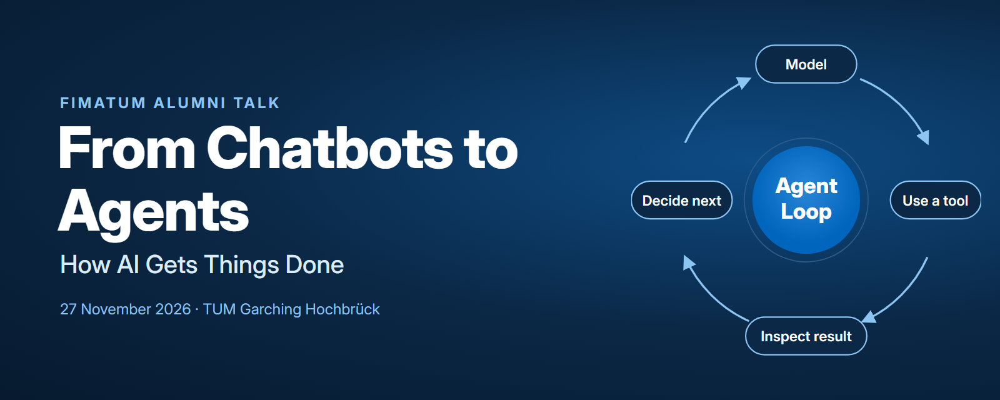

  

  <a href="https://fimatum.de/events/2026-11-27-from-chatbots-to-agents/"><b>Event page</b></a> ·
  <a href="From%20Chatbots%20to%20Agents.pdf"><b>Slides (PDF)</b></a> ·
  <a href="demo/dist/harness-replay.html"><b>Demo replay</b></a> ·
  <a href="demo/README.md"><b>Run the demo yourself</b></a>

# From Chatbots to Agents

Material of the FiMaTUM alumni talk **"From Chatbots to Agents: How AI Gets Things Done"**.
The talk was on 27 November 2026 at TUM Garching Hochbrück.

> How does a chatbot become a system that tackles mathematical problems?
> Go behind the scenes of Claude Code and Codex. No prior knowledge required.

## What the talk covers

| Part | Topic | What you learn |
|---|---|---|
| 1 | **How does an agent really work?** | From a chatbot to an agent, in five small steps: model, chat, tools, loop and harness. |
| 2 | **An agent in action** | A live demo. A real agent works on a math task, and we look at every step. |
| 3 | **Tools and MCP** | How the model knows its tools. How MCP connects a service to every harness. Why too many tools fill the context, and how gateways and Code Mode help. |
| 4 | **Limits and outlook** | Where agents get stuck and what helps. A personal assistant built with Pi. Five tips to start with agents yourself. |

Along the way, the audience answered four short polls on their phones.

## Slides

[**From Chatbots to Agents.pdf**](From%20Chatbots%20to%20Agents.pdf) has all slides of the talk.
The last slides are a backup section with more details about the harness and the context.

## Live demo

The folder [demo](demo) has the stage demo of the talk.
It shows in five stages what the software around a model (the harness) does:

1. **Model**: the model gets one question and writes its answer.
2. **Chat**: a messages list holds the conversation. Each model call gets the full list.
3. **Tools**: the model makes one tool call. The harness runs it and adds the result to the list.
4. **Loop**: the model writes a Goldbach checker, runs it and decides the next step after each result.
5. **Harness**: permission checks, and compaction when the list gets too long.

To watch it, download [demo/dist/harness-replay.html](demo/dist/harness-replay.html) and open it in a browser.
The file needs no server and makes no model calls.
Click a stage, then press <kbd>Space</kbd> to go step by step.

[demo/README.md](demo/README.md) tells how to run the demo live with your own model.

## Speaker

Alexander Kammerer, Software Engineering Lead at finccam and President of the [FiMaTUM Alumni Club](https://fimatum.de).
